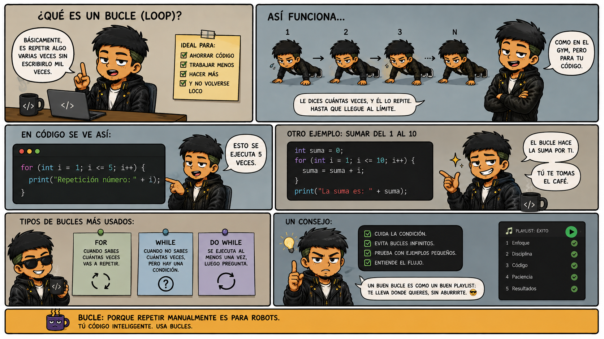

# 🔁 Ciclo `Para` en PSeInt

llegó la hora de dejar de repetir código como si no hubiera un mañana!

## 🧠 ¿Qué es un ciclo?

Imagina que necesitas mostrar un mensaje diez veces en pantalla.

Podrías escribir diez instrucciones `Escribir`, una debajo de la otra. Pero ¿qué pasaría si necesitas mostrarlo 100 o 1.000 veces?

Sería demasiado trabajo.

Para eso existen los **ciclos o bucles**: estructuras que permiten repetir instrucciones sin tener que escribirlas una y otra vez.

<!-- Revisas si muevo la imagen a otro lado por el momento se quda aca. -->



## 🔄 ¿Qué es el ciclo `Para`?

El ciclo `Para` se utiliza cuando conocemos de antemano cuántas veces queremos repetir una serie de instrucciones.

Por ejemplo, si queremos mostrar un mensaje cinco veces, podemos utilizar un ciclo `Para` y dejar que el programa se encargue de repetirlo.

En pocas palabras:

**Tú le dices desde dónde empieza, hasta dónde llega y cómo avanza. El ciclo se encarga de repetir las instrucciones.**

## 💻 Sintaxis en PSeInt

```pseint
Para (variable) <- inicio Hasta fin Hacer
    // Instrucciones que se repetirán
FinPara
```

```
Para i <- 1 Hasta 5 Hacer
Escribir i
FinPara

```

Veamos qué significa cada parte:

- **`Para`:** indica que comienza el ciclo.
- **`variable`:** almacena el valor del contador.
- **`inicio`:** indica el valor desde el que comienza.
- **`Hasta fin`:** establece el valor límite.
- **`Hacer`:** indica dónde empiezan las instrucciones que se repetirán.
- **`FinPara`:** marca el final del ciclo.

## Ejemplo 1: mostrar números del 1 al 5

```pseint
Algoritmo ContarHastaCinco
    Para i <- 1 Hasta 5 Hacer
        Escribir "Repeticion numero: ", i
    FinPara
FinAlgoritmo
```

### ¿Qué está pasando?

1. El contador `i` comienza en 1.
2. El programa muestra el valor actual de `i`.
3. El ciclo avanza al siguiente valor.
4. Las instrucciones se repiten hasta llegar al límite.
5. Cuando termina el ciclo, el programa continúa después de `FinPara`.

La salida será:

```text
Repeticion numero: 1
Repeticion numero: 2
Repeticion numero: 3
Repeticion numero: 4
Repeticion numero: 5

```

¡Y todo eso con unas pocas líneas de código! 🔥
Pruébalo y me cuentas ;)

## ➕ Ejemplo 2: sumar los números del 1 al 10

Ahora vamos a utilizar el ciclo para algo más interesante: acumular una suma.

```pseint
Algoritmo SumarDelUnoAlDiez

//Datos
    Definir i, suma Como Entero

    suma <- 0

//Procesos
    Para i <- 1 Hasta 10 Hacer
        suma <- suma + i
    FinPara

//Salidas

    Escribir "La suma es: ", suma
FinAlgoritmo
```

### ¿Cómo funciona?

Primero, `suma` comienza en cero.

Después, en cada repetición, agregamos el valor actual de `i` a la variable `suma`.

| Repetición | Valor de `i` | Valor acumulado de `suma` |
| ---------: | -----------: | ------------------------: |
|          1 |            1 |                         1 |
|          2 |            2 |                         3 |
|          3 |            3 |                         6 |
|          4 |            4 |                        10 |
|        ... |          ... |                       ... |
|         10 |           10 |                        55 |

El resultado final es **55**.

La clave está en esta instrucción:

```pseint
suma <- suma + i
```

No estamos simplemente reemplazando el valor de `suma`: estamos tomando lo que ya tiene y agregándole el valor actual del contador.

## ⚖️ ¿Cuándo utilizo `Para`?

Utiliza `Para` cuando sabes cuántas repeticiones necesitas, por ejemplo:

- Mostrar los números del 1 al 100.
- Recorrer una serie de valores.
- Calcular la suma de varios números.
- Mostrar una tabla de multiplicar.
- Repetir una operación una cantidad determinada de veces.

Si necesitas repetir instrucciones mientras una condición se cumpla y no sabes de antemano cuántas repeticiones serán necesarias, también debes aprender los ciclos `Mientras` y `Repetir`.

## ⚠️ Errores comunes

- **Olvidar `FinPara`:** el ciclo necesita su instrucción de cierre.
- **Confundir el contador con el acumulador:** `i` controla las repeticiones; `suma` guarda el resultado acumulado.
- **No inicializar el acumulador:** si vas a sumar valores, comienza con `suma <- 0`.
- **Creer que el ciclo siempre se repite una cantidad fija:** eso depende de cómo lo configures y de los límites establecidos.

## 🎯 Mini reto

¡Ahora te toca a ti!

1. Muestra los números del 1 al 20.
2. Muestra los números pares del 2 al 20, avanzando de dos en dos.
3. Calcula la suma de los números del 1 al 100.
4. Pide un número al usuario y muestra su tabla de multiplicar del 1 al 10.

**Consejo de programador:** no te limites a copiar el código. Cambia los valores, ejecútalo y observa qué ocurre. Ahí es donde realmente empiezas a entender la lógica.

---

_Apunte creado para aprender lógica de programación paso a paso en Diccionario-Dev._
