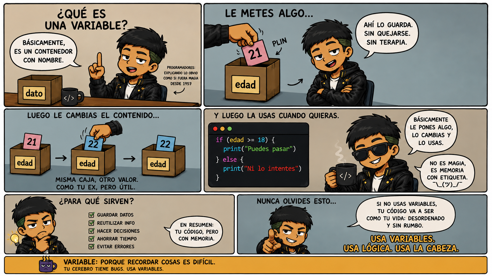

# ☕ Java: por qué escribes tanto para hacer tan poco

> ¿Alguna vez miraste tu primer programa en Java y pensaste _"¿por qué rayos necesito escribir 5 líneas para imprimir un 'Hola'?"_
>
> Tranquilo, no eres el único. Bienvenido al club.

Este README es una guía para entender **qué significa cada palabra rara** que Java te obliga a escribir. No es memorizar, es entender por qué están ahí.

---

## 🤔 El trauma inicial

Todos empezamos igual. Escribes tu primer programa en Java y ves esto:

```java
public class HolaMundo {
    public static void main(String[] args) {
        System.out.println("Hola, mundo");
    }
}
```

Y piensas:

> 😵 **"En Python esto es una línea. ¿Por qué Java me está gritando?"**

Respira. Vamos a desarmar esta cosa pieza por pieza, como si fuera un LEGO.

---

## 🧱 Parte 1: `public class HolaMundo`

```java
public class HolaMundo { ... }
```

### ¿Qué es `class`?

Java es un lenguaje **orientado a objetos**, y todo en Java vive dentro de una **clase**. Piensa en una clase como una **caja grande** donde metes cosas: variables, métodos, todo.

<!-- Revisas si muevo la imagen a otro lado por el momento se quda aca. -->



En PSeInt, todo vivía dentro de `Algoritmo ... FinAlgoritmo`. En Java, todo vive dentro de `class ... { }`.

### ¿Qué es `public`?

`public` significa **"visible para todos"**. Es un modificador de acceso.

Piensa en una casa:

- **`public`** → la fachada. Cualquiera puede verla.
- **`private`** → tu habitación. Solo tú.
- **`protected`** → la sala familiar. Solo los de la casa.

Por ahora solo necesitas saber que `public` significa "accesible desde cualquier lado". Ya aprenderás los demás.

### ¿Por qué el nombre debe coincidir con el archivo?

Porque Java es un obsesivo del orden. Si tu clase se llama `HolaMundo`, el archivo **obligatoriamente** debe llamarse `HolaMundo.java`. Mayúsculas y todo.

> ⚠️ Si lo nombras `holamundo.java` con minúscula, Java te va a decir: "No sé qué estás haciendo, pero no".

**Equivalencia PSeInt → Java:**

| PSeInt                 | Java                               |
| ---------------------- | ---------------------------------- |
| `Algoritmo MiPrograma` | `public class MiPrograma`          |
| `FinAlgoritmo`         | `}` (la llave que cierra la clase) |

---

## 🚪 Parte 2: `public static void main(String[] args)`

Esta es la línea que hace que todo el mundo llore. Vamos por partes.

### ¿Qué es `main`?

`main` es el **nombre especial** que Java busca para empezar a ejecutar tu programa.

Cuando le das "Run", Java busca el método llamado `main` y dice: "Ok, aquí empiezo". Sin `main`, tu programa no corre. Es el punto de entrada.

En PSeInt no tenías que escribir esto porque el algoritmo ya sabía dónde empezar. En Java, **tú debes decirle dónde**.

### ¿Por qué `public`?

Porque Java necesita poder **llamar a `main` desde afuera** (desde el sistema operativo o el IDE). Si fuera `private`, nadie podría ejecutarlo.

> 🤔 **"¿Y quién lo llama?"** → El sistema. Literalmente, la máquina virtual de Java le dice: "Ey, `main`, arranca".

### ¿Por qué `static`?

Aquí viene la parte bonita.

Normalmente, para usar algo de una clase, necesitas **crear un objeto** de esa clase. Por ejemplo:

```java
Persona p = new Persona(); // Creas un objeto
p.saludar();               // Y usas sus métodos
```

Pero si `main` necesitara crear un objeto de su propia clase para funcionar, sería un problema: ¿quién crea ese objeto? ¿El objeto de quién?

`static` significa: **"este método pertenece a la clase, NO a un objeto específico"**. Así Java puede llamar a `main` **sin necesidad de crear un objeto**.

> 💡 **Analogía simple:** un método `static` es como una máquina expendedora en la calle. No necesitas "tener" la máquina para usarla. Está ahí, disponible. Un método no-static es como una cafetera personal: necesitas tener la cafetera para usarla.

### ¿Por qué `void`?

`void` significa **"no devuelve nada"**.

En PSeInt tenías funciones que devolvían un valor y otras que solo hacían algo. En Java, todas las funciones deben declarar **qué devuelven**. Si no devuelven nada, se pone `void`.

`main` no devuelve nada porque solo ejecuta el programa. Nadie espera un resultado de vuelta.

### ¿Por qué `String[] args`?

`args` es un **arreglo de textos**. Guarda los parámetros que se pasan al programa desde la consola.

Por ejemplo, si ejecutas:

```bash
java MiPrograma hola mundo
```

Entonces `args` contiene `["hola", "mundo"]`. Puedes acceder a ellos con `args[0]`, `args[1]`, etc.

Si nunca pasas parámetros, `args` estará vacío. Pero **debe existir** porque Java exige esa firma exacta para reconocer el método `main`.

### 🧩 Todo junto

```java
public static void main(String[] args) { ... }
```

Traducción al español:

> **"Este método es visible para todos (`public`), pertenece a la clase y no a un objeto (`static`), no devuelve nada (`void`), se llama `main` y recibe un arreglo de textos (`String[] args`)."**

Ya sé. Sigue siendo largo. Pero ahora **sabes qué significa cada palabra**, no solo las escribes de memoria.

**Equivalencia PSeInt → Java:**

| PSeInt                            | Java                                     |
| --------------------------------- | ---------------------------------------- |
| El inicio implícito del algoritmo | `public static void main(String[] args)` |

---

## 🖨️ Parte 3: `System.out.println("Hola, mundo")`

Otra línea que parece un trabalenguas. Vamos a desmenuzarla.

### ¿Qué es `System`?

`System` es una clase que Java trae incluida. Contiene herramientas para interactuar con el sistema (entrada, salida, errores, etc.).

### ¿Qué es `out`?

`out` es un **atributo estático** de `System` que representa la **salida estándar**. O sea, la consola donde ves los mensajes.

> 📌 **Nota:** `out` es la salida normal. También existe `err` para mensajes de error. Y `in` para la entrada (sí, el mismo que usa `Scanner`).

### ¿Qué es `println`?

`println` = **print line** = "imprime y salta de línea".

- `println("Hola")` → imprime "Hola" y baja a la siguiente línea.
- `print("Hola")` → imprime "Hola" sin saltar de línea.

### 🧩 La ruta completa

```
System  →  la clase con herramientas del sistema
  .out  →  la salida estándar (la consola)
  .println(...)  →  el método que imprime y salta de línea
```

Leyéndolo de izquierda a derecha:

> **"De la clase `System`, usa el objeto `out`, y ejecuta su método `println`."**

Es como dar indicaciones de una dirección: **Casa → Habitación → Cama**.

**Equivalencia PSeInt → Java:**

| PSeInt                       | Java                          |
| ---------------------------- | ----------------------------- |
| `Escribir "Hola"`            | `System.out.println("Hola");` |
| `Escribir Sin Saltar "Hola"` | `System.out.print("Hola");`   |

---

## 📦 Parte 4: ¿Por qué Java es tan verboso?

Buena pregunta. Y la respuesta tiene que ver con el **diseño del lenguaje**.

Java se creó en 1995 con una meta: **ser un lenguaje serio para sistemas grandes**. Eso significa:

- **Todo debe ser explícito.** Nada de adivinar.
- **El compilador te avisa antes de ejecutar.** Por eso exige tipos, llaves, nombres exactos.
- **El código debe ser legible para otros.** Aunque escribas más, cualquiera lo entiende rápido.

Comparemos:

**🐍 Python (relajado):**

```python
print("Hola")
```

**☕ Java (estricto):**

```java
public class Main {
    public static void main(String[] args) {
        System.out.println("Hola");
    }
}
```

Python te deja ser libre. Java te obliga a **ordenar tus ideas antes de escribir**.

> 🎯 **Consejo mental:** Java no es complicado porque quiera torturarte. Es exigente porque está diseñado para proyectos grandes donde el orden importa más que la rapidez de escribir.

---

## 🎨 Parte 5: Las llaves `{ }` y el `;`

Estas dos cositas son la causa #1 de errores en principiantes. Así que presta atención.

### Las llaves `{ }`

Delimitan **bloques de código**. Como `FinSi`, `FinPara`, `FinAlgoritmo` en PSeInt, pero más compacto.

```java
public class Main {     // ← Abre la clase
    public static void main(String[] args) {  // ← Abre el método
        System.out.println("Hola");           // ← Instrucción
    }                                          // ← Cierra el método
}                                              // ← Cierra la clase
```

Cada `{` debe tener su `}`. Y deben estar **anidadas correctamente**.

> ⚠️ Si te falta una llave, Java te va a decir que "falta un símbolo" y te va a volver loco buscando dónde. Sí, ya lo vas a vivir. 😂

### El `;`

Cada instrucción termina con `;`. **Punto**. Sin excepciones (bueno, casi).

```java
int edad = 20;                       // ✅ Lleva ;
System.out.println("Hola");          // ✅ Lleva ;
if (edad >= 18) { ... }              // ❌ El if NO lleva ; después de la llave
```

**¿Por qué existe el `;`?**

Porque Java necesita saber **dónde termina una instrucción**. En PSeInt, cada línea se interpretaba sola. En Java, podrías escribir todo en una sola línea y el `;` separa las instrucciones.

> 💡 **Truco:** mira tu código y pregúntate "¿esta línea hace algo?". Si la respuesta es sí, probablemente lleva `;`.

---

## 🔍 Parte 6: La receta completa

Vamos a armar el esqueleto mínimo de un programa Java, anotado:

```java
// 1. Importar herramientas (opcional, solo si las usas)
import java.util.Scanner;

// 2. Declarar la clase (nombre = nombre del archivo)
public class MiPrograma {

    // 3. Método principal (punto de entrada, siempre igual)
    public static void main(String[] args) {

        // 4. Aquí va tu código
        System.out.println("Hola, mundo");

    } // ← Cierra main
} // ← Cierra la clase
```

**Plantilla mental para memorizar:**

```
Importación (si hace falta)
  ↓
Clase pública (nombre = archivo)
  ↓
Método main (siempre igual)
  ↓
Tu código aquí
```

Cada programa Java que hagas va a seguir este esqueleto. **Siempre**. Con el tiempo lo escribirás sin pensar.

---

## 📊 Tabla resumen: PSeInt vs Java

| Concepto            | PSeInt                | Java                            |
| ------------------- | --------------------- | ------------------------------- |
| Inicio del programa | `Algoritmo Nombre`    | `public class Nombre` + `main`  |
| Fin del programa    | `FinAlgoritmo`        | `}` (última llave)              |
| Imprimir            | `Escribir "Hola"`     | `System.out.println("Hola");`   |
| Imprimir sin salto  | `Escribir Sin Saltar` | `System.out.print("Hola");`     |
| Leer dato           | `Leer edad`           | `Scanner` + `entrada.nextInt()` |
| Separador           | Salto de línea        | `;`                             |
| Bloques             | `FinSi`, `FinPara`    | `{ }`                           |
| Comentario          | `//`                  | `//`                            |

---

## ⚠️ Errores que vas a cometer (y está bien)

- **Olvidar un `;`** → Java te dirá "expected ';'". Busca la línea.
- **Olvidar una `}`** → "reached end of file while parsing". Busca la llave que falta.
- **Escribir mal el nombre del archivo** → "class is public, should be declared in a file named...". Ajústalo.
- **Olvidar el `main`** → "Main method not found in class". Copia el esqueleto de nuevo.
- **Escribir `System.out.printline`** → No existe. Es `println` (print line).
- **Escribir `system.out`** con minúscula → No existe. `System` va con mayúscula.

> 🎯 **Regla de oro:** Java es case-sensitive. `System` y `system` son cosas distintas. Igual con `String` vs `string`.

---

## 🚀 Conclusión

Java no es "difícil". Es **explícito**. Te obliga a decirle **todo** lo que quieres hacer, sin atajos, sin adivinanzas.

Y eso es justamente lo que lo hace un lenguaje serio, usado en bancos, apps, empresas y sistemas críticos.

Cuando alguien te diga:

> _"Java escribe demasiado para hacer tan poco"_

Tú respondes:

> _"Java no escribe mucho. Solo te obliga a ser claro. "_

Una vez que entiendas **por qué** están esas palabras raras, dejan de ser raras. Se vuelven obvias. Y ya no las escribes porque toca, sino porque **sabes por qué están ahí**.

**No memorices Java. Entiéndelo.**

---

_Apunte de sintaxis Java creado para Diccionario-Dev. Si encuentras un error o quieres aportar, abre un Issue o un Pull Request._
