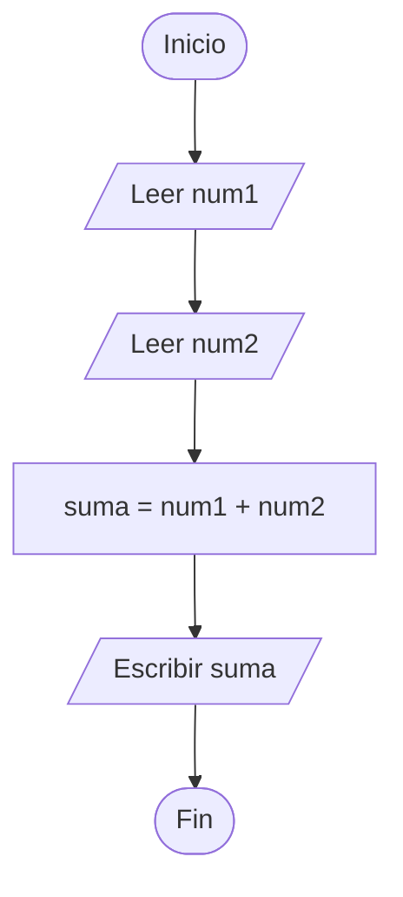
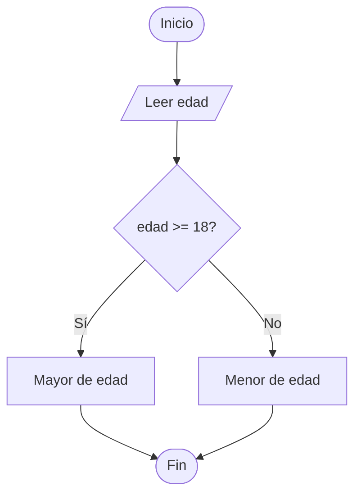
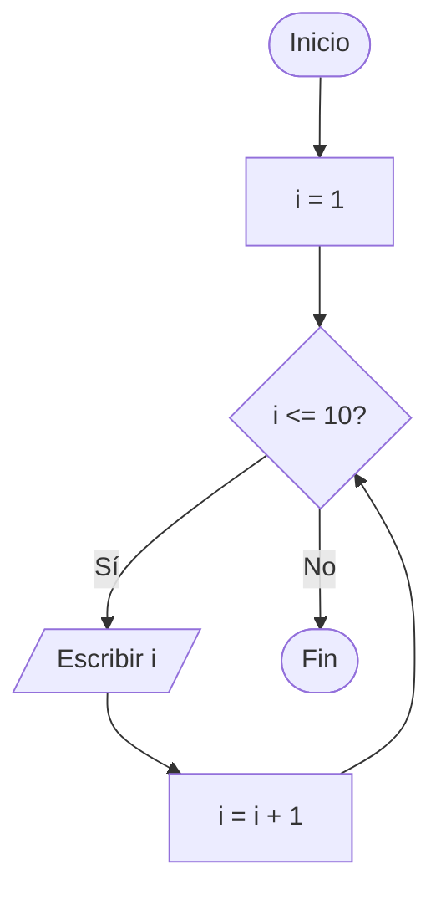
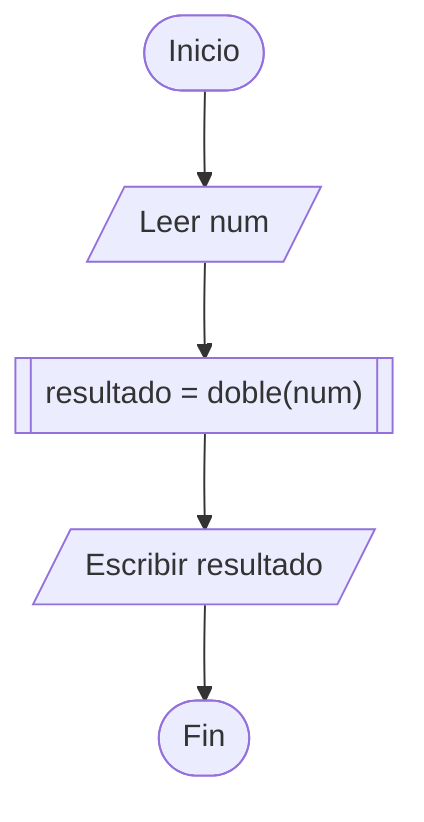

# 📊 Diagramas de flujo

> Antes de construir algo, viene bien tener un plan. Un diagrama de flujo nos ayuda a organizar las ideas antes de comenzar a programar.

---

## 🤔 ¿Qué es un diagrama de flujo?

Un **diagrama de flujo** es una representación gráfica de un algoritmo o proceso. En lugar de escribir código, representamos la lógica con **símbolos conectados por flechas**, mostrando paso a paso qué hace el programa y en qué orden.

Podemos verlo como una versión visual del pseudocódigo. Por ejemplo, en lugar de escribir `Si...Entonces`, utilizamos un rombo que representa una condición y dos caminos: uno para el `Sí` y otro para el `No`.

> **Si estás comenzando:** imagina que el pseudocódigo es una receta escrita y el diagrama de flujo es esa misma receta representada con dibujitos. Ambos explican los mismos pasos, pero de maneras diferentes.
>
> No se trata de hacer trabajo adicional sin motivo, sino de comprender la lógica antes de escribir el código. Y si al principio te cuesta, no te preocupes: con práctica, cada vez será más fácil.

---

## 🎯 ¿Para qué sirve?

- **Organizar las ideas:** permite planificar la lógica antes de escribir código.
- **Comunicar ideas:** ayuda a explicar un algoritmo de forma visual, incluso a quienes están comenzando a programar.
- **Detectar errores:** permite identificar problemas en la lógica antes de implementar el programa.
- **Documentar:** facilita recordar cómo funciona un algoritmo cuando necesitamos revisarlo más adelante.
- **Estudiar:** ayuda a comprender estructuras como los ciclos y los condicionales.
- **Trabajar en equipo:** permite compartir y discutir una solución antes de comenzar a programarla.

> **También te puede ayudar en clase.** Si necesitas explicar cómo funciona tu algoritmo, un diagrama bien organizado te permite mostrar cada paso y expresar tu razonamiento con mayor claridad. 💡

---

## 🔷 Símbolos básicos y sus funciones

| Símbolo             | Nombre                   | ¿Para qué sirve?                                                                     |
| ------------------- | ------------------------ | ------------------------------------------------------------------------------------ |
| ⬭ Óvalo / Elipse    | **Inicio / Fin**         | Marca dónde comienza y dónde termina el algoritmo.                                   |
| ▭ Rectángulo        | **Proceso**              | Representa una operación, asignación o cálculo.                                      |
| ▱ Paralelogramo     | **Entrada / Salida**     | Representa la lectura de datos o la presentación de resultados (`Leer`, `Escribir`). |
| ◇ Rombo             | **Decisión**             | Representa una condición que permite elegir entre diferentes caminos.                |
| ▭ Con líneas dobles | **Subproceso / Función** | Representa la llamada a un proceso definido por separado.                            |
| ⬤ Círculo pequeño   | **Conector**             | Permite conectar partes del diagrama cuando es necesario.                            |
| → Flecha            | **Flujo**                | Indica la dirección en la que avanza el proceso.                                     |

> **Un detalle importante:** cada símbolo tiene una función específica. Por ejemplo, `Leer` suele representarse con un paralelogramo, mientras que una suma se representa con un rectángulo.
>
> Al principio puede costar recordar todas las formas, pero no necesitas aprenderlas de memoria en un solo día. Puedes consultar esta tabla mientras practicas.

---

## 🧭 ¿Cómo se lee un diagrama de flujo?

1. **Comienza por el óvalo de Inicio.** Desde allí comienza el recorrido del algoritmo.
2. **Sigue las flechas.** Estas indican hacia dónde continúa el proceso.
3. **Interpreta cada símbolo.** El rectángulo representa un proceso, el paralelogramo una entrada o salida y el rombo una decisión.
4. **Observa las decisiones.** En un rombo pueden existir diferentes caminos, como `Sí` y `No`. El recorrido depende de la condición.
5. **Identifica los ciclos.** Algunas flechas regresan a pasos anteriores para repetir instrucciones, como sucede con `Mientras`, `Para` y `Repetir`.
6. **Busca el óvalo de Fin.** Indica dónde termina el recorrido del algoritmo.

> **Un consejo:** intenta recorrer el diagrama paso a paso, como si fueras el programa. Si alguna parte no te queda clara, revísala y comprueba si las conexiones tienen sentido. Corregir y mejorar un diagrama también forma parte del aprendizaje. 💪

---

## ➕ Ejemplo 1: sumar dos números

Este algoritmo recibe dos números, los suma y muestra el resultado.

> Este es un buen ejercicio para comenzar. Te permite practicar la entrada de datos, las operaciones y la salida de resultados.
>
> Si ya sabes sumar dos números en pseudocódigo, intenta identificar en qué parte del diagrama ocurre cada paso. 😊

---

## ◇ Ejemplo 2: ¿mayor o menor de edad?

En este ejemplo, el programa recibe una edad y determina si la persona tiene 18 años o más.

> Aquí aprendemos a representar una decisión mediante un rombo. La condición `edad >= 18` determina cuál de los dos caminos debe seguir el programa.
>
> Recuerda que una condición debe comparar valores compatibles y expresar claramente lo que queremos comprobar.

---

## 🔄 Ejemplo 3: contar del 1 al 10

Este diagrama muestra cómo funciona un ciclo que repite una instrucción mientras se cumpla una condición.

> **Observa el recorrido de las flechas:** después de mostrar el número, el contador aumenta y el programa vuelve a comprobar la condición. Así se repite el proceso.
>
> Cuando `i` llega a 11, la condición `i <= 10` deja de cumplirse y el algoritmo termina.
>
> Si un ciclo no tiene una forma de finalizar, puede convertirse en un **bucle infinito**. Por eso es importante revisar tanto la condición como los cambios que ocurren durante cada repetición [Referancia]().

---

## 🧩 Ejemplo 4: subproceso o función

Un subproceso permite separar una tarea para organizar mejor el algoritmo y reutilizar una operación cuando sea necesario.

> Puedes imaginar un subproceso como una tarea que delegamos a otra parte del programa. En este ejemplo, `doble(num)` representa una operación que recibe un número y calcula su doble.
>
> Separar tareas puede facilitar la lectura, las pruebas y el mantenimiento del código, especialmente cuando los programas comienzan a crecer.

---

## ✅ Reglas para crear buenos diagramas

- **Representa claramente el inicio y el final.** En los ejercicios sencillos suele utilizarse un único punto de inicio y uno de finalización.
- **Mantén una dirección de lectura clara.** De arriba hacia abajo o de izquierda a derecha suelen ser buenas opciones.
- **Etiqueta las salidas de las decisiones.** Puedes utilizar `Sí` y `No`, o `Verdadero` y `Falso`, según corresponda.
- **Conecta los símbolos.** Las flechas deben permitir seguir el recorrido del algoritmo sin confusiones.
- **Utiliza nombres comprensibles.** Por ejemplo, `edadUsuario` puede ser más descriptivo que `x`.
- **Divide los procesos complejos.** Si un diagrama crece demasiado, considera separar algunas tareas en subprocesos.

> **Una recomendación:** intenta diseñar el diagrama antes de programar. Te ayudará a organizar la solución y a detectar posibles problemas desde el principio.
>
> Si ya escribiste el código, también puedes crear un diagrama para documentarlo y comprender mejor su funcionamiento. Lo importante es que te resulte útil para aprender y trabajar con más claridad.

---

## ⚠️ Errores comunes al comenzar

- **Confundir los símbolos:** recuerda que las entradas y salidas suelen ir en paralelogramos y las operaciones en rectángulos.
- **Olvidar el final del algoritmo:** revisa que el recorrido tenga una finalización clara.
- **Dejar conexiones incompletas:** asegúrate de que las flechas permitan seguir el proceso.
- **Diseñar ciclos sin una salida:** comprueba que exista una condición o mecanismo que permita terminar la repetición.
- **Crear condiciones difíciles de entender:** expresa las comparaciones de manera clara y coherente.
- **No revisar el recorrido completo:** sigue las flechas desde el inicio hasta el final para comprobar que la lógica sea consistente.

> Si encuentras alguno de estos errores, tómalo como una oportunidad para mejorar. Todos necesitamos practicar para desarrollar una buena lógica de programación. Lo importante es identificar el problema, entenderlo y corregirlo. 🌱

---

## 🛠️ Herramientas para dibujar diagramas

- **[Draw.io (diagrams.net)](https://www.drawio.com/):** herramienta para crear diagramas de forma visual.
- **[Lucidchart](https://www.lucidchart.com/):** permite crear diagramas en línea y ofrece opciones gratuitas.
- **[Mermaid](https://mermaid.js.org/):** permite crear diagramas mediante texto y mostrarlos en documentos compatibles con Markdown.
- **PSeInt:** puede generar diagramas de flujo a partir del pseudocódigo.
- **Papel y lápiz:** una alternativa sencilla para organizar las ideas antes de utilizar una herramienta digital.

> **Mi recomendación:** comienza con la herramienta que te resulte más cómoda. Puedes dibujar en papel, utilizar PSeInt o trabajar con una aplicación como Draw.io. Lo importante es comprender la lógica; la herramienta viene después. ✏️
>
> Si te equivocas mientras dibujas, puedes modificar el diagrama y volver a intentarlo. Estás aprendiendo, así que date tiempo para practicar.

---

## 🔗 Relación entre diagrama de flujo, pseudocódigo y código

| Nivel                 | Qué representa                                        | Ejemplo                    |
| --------------------- | ----------------------------------------------------- | -------------------------- |
| **Diagrama de flujo** | La lógica de forma visual.                            | Un rombo con `edad >= 18`. |
| **Pseudocódigo**      | La lógica expresada mediante instrucciones sencillas. | `Si edad >= 18 Entonces`.  |
| **Código real**       | La solución escrita en un lenguaje de programación.   | `if (edad >= 18) { ... }`. |

Los tres pueden representar la misma lógica de diferentes maneras. El diagrama ayuda a visualizar el proceso, el pseudocódigo permite describirlo por escrito y el código implementa la solución en un lenguaje de programación.

> **Para recordar:** planificar la lógica antes de programar puede ayudarte a comprender mejor el problema. Puedes empezar con un diagrama, continuar con pseudocódigo y después escribir el código.
>
> No es necesario que siempre trabajes de esa manera: con la práctica aprenderás qué método te resulta más útil según el problema. Cada persona avanza a su propio ritmo. 🚶‍♂️

---

## Para terminar

> **El diagrama de flujo es el mapa; el código, el viaje. Planificar la ruta puede ayudarte a llegar a tu objetivo con mayor claridad.**

Un diagrama a la vez. Un error a la vez. Un aprendizaje a la vez. 💻

Y si algún día te sientes frustrado, haz una pausa y vuelve a intentarlo cuando estés listo. Aprender programación lleva tiempo, y cada ejercicio es una oportunidad para mejorar.

[¿Comó detectar un error?](../fundamentos/como-detectar-errores.md)
